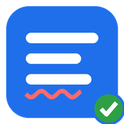
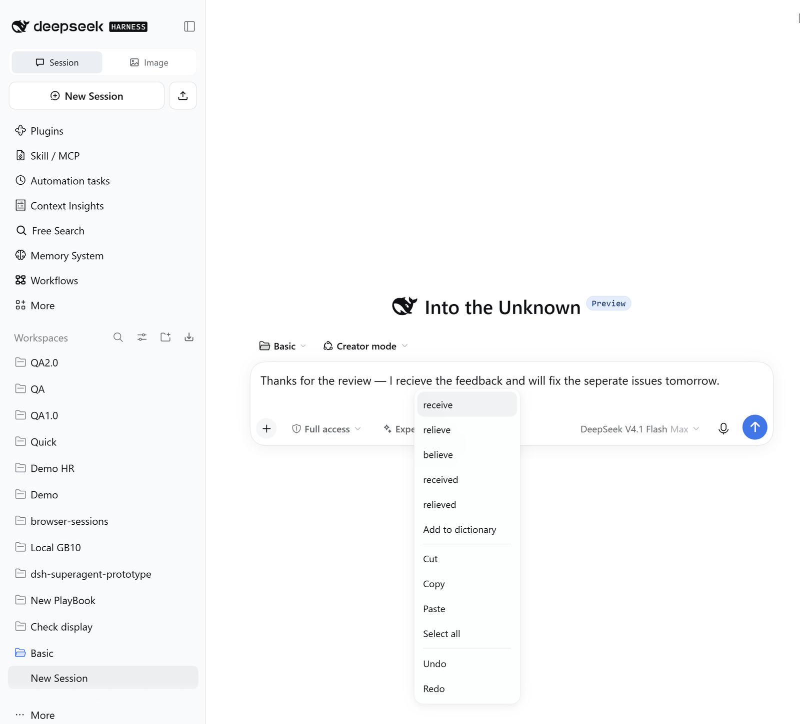
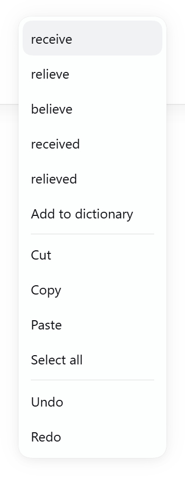
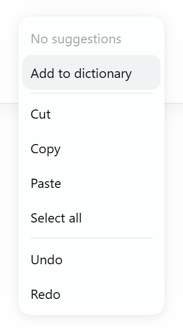
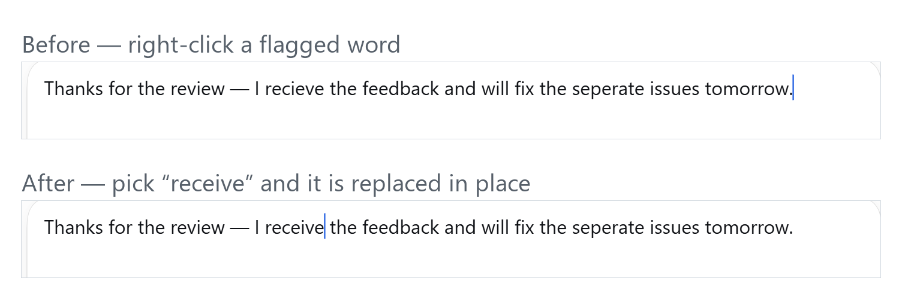
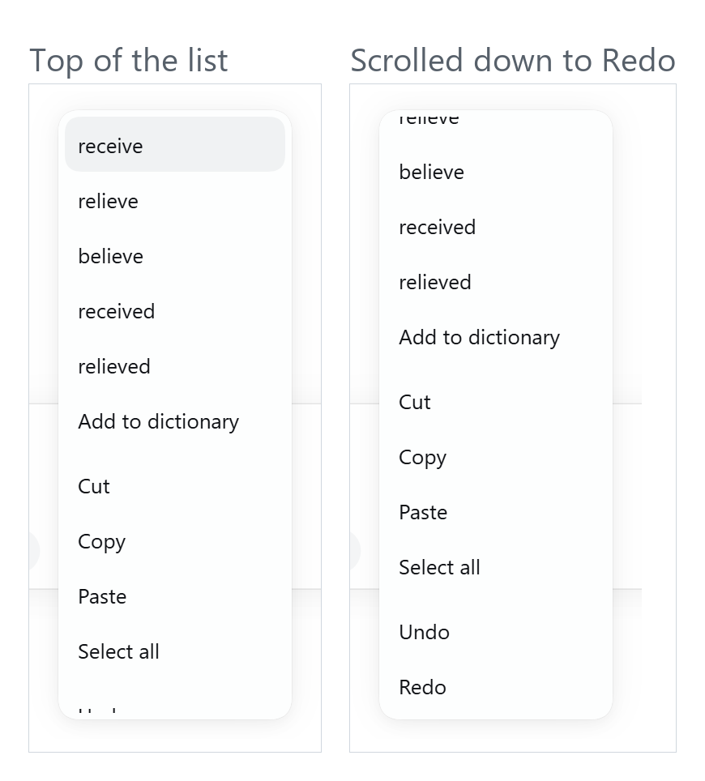

<p align="center">
  
</p>

<h3 align="center">Composer spellcheck</h3>

<p align="center">
  <strong>Right-click spelling in the DeepSeek Harness message composer.</strong><br>
  Ranked suggestions, plus the cut / copy / paste actions the desktop shell took away.
</p>

<p align="center">
  <a href="#install"></a>
  <a href="LICENSE"></a>
  <a href="package.json"></a>
</p>

<p align="center">
  
</p>

The desktop shell does not give the chat box a native context menu. This plugin
fills that gap: right-click a misspelled word in the composer and the menu opens
with ranked suggestions, followed by the clipboard actions you expected to find
there.

---

## Suggestions that fit the word

Up to five candidates, ranked by edit distance first and word frequency second.
`recieve` offers `receive` before `relieve` or `believe`; case is preserved, so
`Recieve` becomes `Receive` at the start of a sentence.

## The clipboard actions come back

<p align="center">
  
</p>

Cut, Copy, Paste, Select all, Undo and Redo sit below a separator. The menu
replaces the native one rather than competing with it, and the plugin only ever
opens on a right-click inside a real composer field — it never patches anything
else. Chromium's own red squiggles keep working.

## Your own vocabulary

<p align="center">
  
</p>

`Add to dictionary` stores the word in `localStorage`, so it stops being flagged
without a rebuild. Words with no close match still get the clipboard actions —
you are never left with an empty menu.

## Before and after

<p align="center">
  
</p>

Picking a suggestion edits the text node in place and puts the caret where it
was, so the rest of the paragraph is untouched.

## Long menus

<p align="center">
  
</p>

The list can hold up to twelve rows. A tall window fits them all; a short window
clamps the menu to the viewport and the list scrolls — with the wheel, or with
<kbd>↑</kbd> / <kbd>↓</kbd>, which keeps the focused row in view.

The app's own menu already clamps and scrolls, so the plugin adds a safety net
instead of styling it: after paint it measures the menu, and **only** touches the
one carrying its own labels. If the host styles ever stop clamping, the plugin
clamps; when the host already did the right thing, the plugin changes nothing and
re-checks on resize.

---

## Install

From **Settings → Plugins**, choose *install from a local folder* and pick this
directory. Reload with <kbd>Ctrl</kbd>+<kbd>R</kbd> (or <kbd>⌘</kbd>+<kbd>R</kbd>),
and the menu is live.

Or from a terminal:

```bash
dsh plugin --profile <name> add <path-or-git-url>
```

The package is `@osman3n/dsh-composer-spellcheck`. Its client half declares
`@deepseek-ai/dsh-client-ui-context-menu` in `dsh.client.inject`, so it waits for
the menu service to exist instead of assuming it, and activates quietly when the
service is not there yet.

## How it works

One capture-phase `contextmenu` listener on `document`, scoped to
`[data-composer-input]`. Inside that field it resolves the caret with
`caretPositionFromPoint`, reads the word under it, and skips code, links and
anything marked `spellcheck="false"`. When the word is unknown it opens the menu
with suggestions plus the standard actions; when the word is known it stays out
of the way.

## Files

| File | Purpose |
| --- | --- |
| `index.js` | Host half — a no-op, kept so the package loads cleanly |
| `client.js` | The built browser bundle (no dependencies, one file) |
| `src/client.template.js` | The authored source the bundle is built from |
| `tools/build-client.mjs` | Inlines the word list and typo map into `client.js` |
| `tools/test-client.mjs` | Behaviour tests, no DOM required |
| `tools/make-figures.py` | Composes the screenshots above from captured frames |
| `locale/en.json`, `locale/zh.json` | Copy for every label |

## Rebuild

```bash
node tools/prepare-words.mjs --limit=30000 --min-count=2
node tools/build-client.mjs
node tools/test-client.mjs
```

The build is reproducible: running it twice produces byte-identical output.

## Dictionary

Roughly 30,000 words, built from the
[FrequencyWords](https://github.com/hermitdave/FrequencyWords) corpus (CC-BY-SA)
plus a curated allowlist and a typo map for the mistakes people actually make.
Purely informal spellings such as `dont`, `cant` and `youre` are dropped, so they
still look like mistakes.

## Limits

- Suggestions are capped at five, and at edit distance 2.
- The composer is a Lexical editor, so the plugin edits its text nodes rather
  than setting `value` on a field.
- The dictionary ships inside `client.js`; adding a lot of words means a rebuild.
- Chromium's squiggles are cosmetic — turning them off changes nothing here.

## License

MIT
