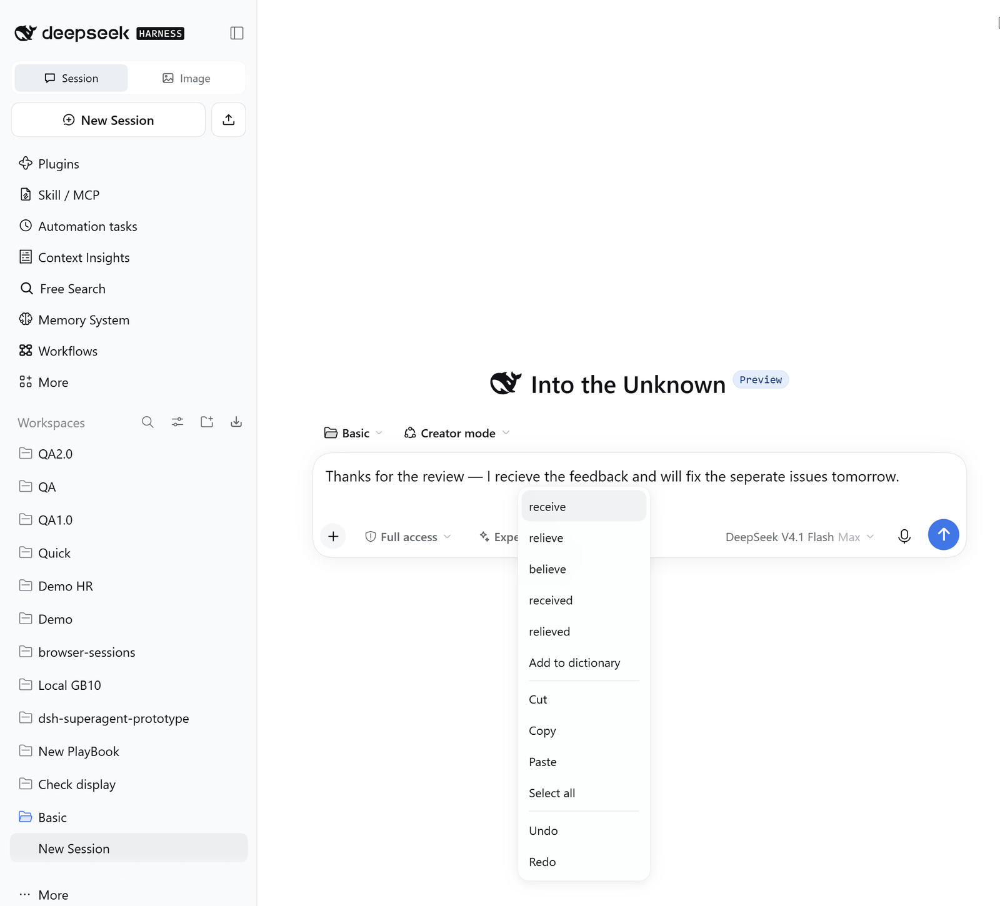
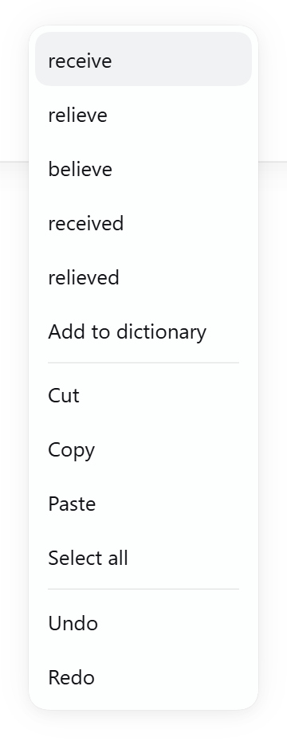
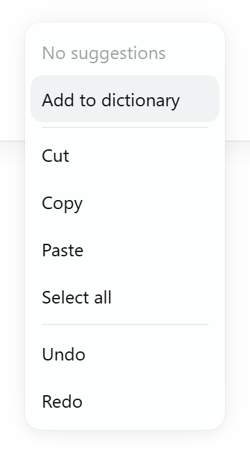
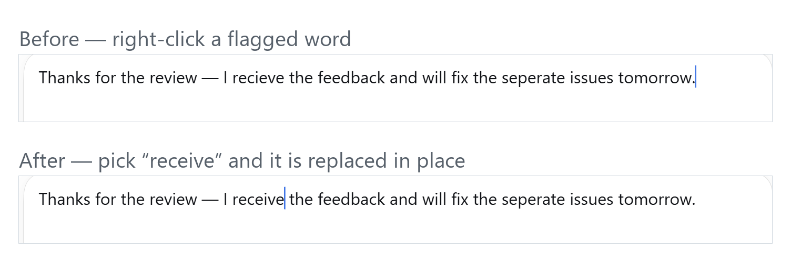
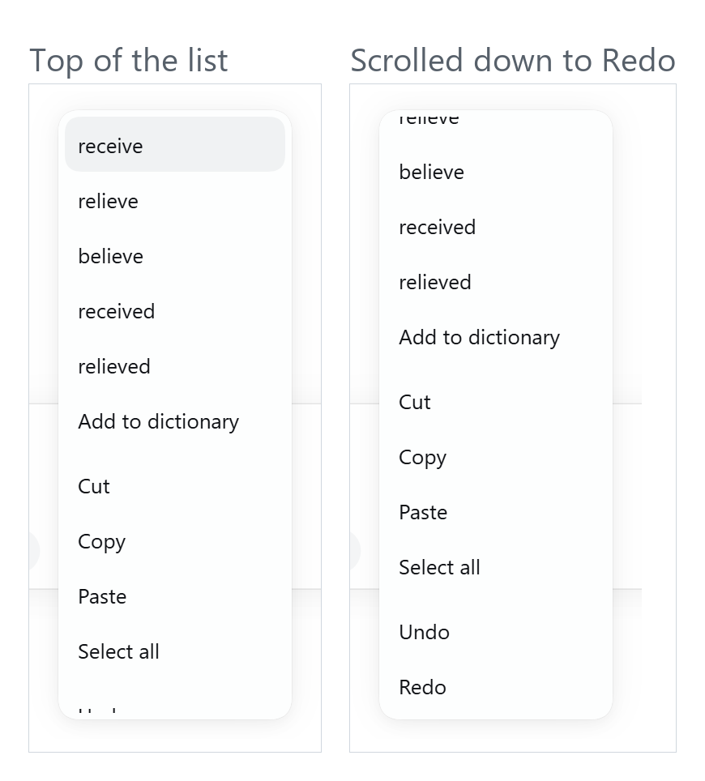

<p align="center">
  
</p>

<h3 align="center">拼写建议（Spell suggestions）</h3>

<p align="center">
  <strong>在 DeepSeek Harness 消息输入框里右键改拼写。</strong><br>
  按相近程度排序的建议，外加桌面端拿掉的剪切 / 复制 / 粘贴等操作。
</p>

<p align="center">
  <a href="#安装"></a>
  <a href="LICENSE"></a>
  <a href="package.json"></a>
</p>

<p align="center">
  
</p>

桌面端没有给聊天输入框提供原生右键菜单。这个插件补上了这一块：在输入框里
右键一个拼错的单词，菜单会先给出按相近程度排序的建议，后面接上你原本期望
在那里的剪贴板操作。

<p align="center">
  <a href="README.md">English</a> · <strong>简体中文</strong>
</p>

---

## 建议跟着词走

最多五个候选词，先按编辑距离、再按词频排序。`recieve` 会把 `receive` 排在
`relieve` 和 `believe` 前面；大小写会保留，所以句首的 `Recieve` 改完是
`Receive`。

## 剪贴板操作回来了

<p align="center">
  
</p>

剪切、复制、粘贴、全选、撤销和重做位于一条分隔线之后。这个菜单是**替换**原生
菜单而不是跟它抢事件；插件只在输入框内真正右键时打开，不会去改别的地方。
Chromium 自带的红色波浪线照常工作。

## 你自己的词表

<p align="center">
  
</p>

`Add to dictionary` 会把单词存进 `localStorage`，不用重新构建就不再提示。
没有相近词的单词也照样有剪贴板操作，菜单不会是空的。

## 改之前和改之后

<p align="center">
  
</p>

选中建议后是就地修改对应的文本节点，并把光标放回原处，段落其他部分不受影响。

## 小窗口下的长菜单

<p align="center">
  
</p>

列表最多十二行。窗口够高时全部显示；窗口矮时菜单会被夹到视口内，列表可以
滚动 —— 滚轮可以，<kbd>↑</kbd> / <kbd>↓</kbd> 也可以，而且始终让选中的行
保持可见。

应用自带的菜单本来就会夹住并滚动，所以插件加的是一层**兜底**而不是样式覆盖：
渲染完成后量一次菜单尺寸，并且**只**处理带有本插件标签的那一个。如果宿主样式
哪天不再夹住菜单，插件就自己夹；宿主已经做对时插件什么也不改，只在窗口尺寸
变化时重新检查一次。

---

## 安装

在 **设置 → 插件** 里选择*从本地文件夹安装*，指向这个目录，然后
<kbd>Ctrl</kbd>+<kbd>R</kbd>（macOS 是 <kbd>⌘</kbd>+<kbd>R</kbd>）刷新即可。

也可以用命令行：

```bash
dsh plugin --profile <name> add <path-or-git-url>
```

包名是 `@osman3n/dsh-spell-suggestions`。它的浏览器端在
`dsh.client.inject` 里声明了 `@deepseek-ai/dsh-client-ui-context-menu`，
所以会等到菜单服务出现再工作，而不是假设它一定在；服务还没到时它会安静地
待着，不会让启动失败。

## 工作原理

在 `document` 上挂一个捕获阶段的 `contextmenu` 监听器，作用域限定在
`[data-composer-input]`。只有在真实输入框内，它才会用
`caretPositionFromPoint` 定位光标、取出光标下的单词，并跳过代码、链接和任何
标了 `spellcheck="false"` 的内容。单词不认识时才打开菜单；单词正常时它完全
不插手。

## 文件说明

| 文件 | 作用 |
| --- | --- |
| `index.js` | 宿主端 —— 空实现，只为让包能正常加载 |
| `client.js` | 构建产物，浏览器端单文件、无依赖 |
| `src/client.template.js` | 构建所依据的源码 |
| `tools/build-client.mjs` | 把词表和错拼表内联进 `client.js` |
| `tools/test-client.mjs` | 行为测试，不需要 DOM |
| `tools/make-figures.py` | 把截图拼成上面这些图 |
| `locale/en.json`、`locale/zh.json` | 所有文案 |

## 重新构建

```bash
node tools/prepare-words.mjs --limit=30000 --min-count=2
node tools/build-client.mjs
node tools/test-client.mjs
```

构建是可复现的：连跑两次，输出逐字节相同。

## 词表

大约 30,000 个单词，来自 [FrequencyWords](https://github.com/hermitdave/FrequencyWords)
语料（CC-BY-SA），另加一份人工白名单和一张常见错拼表。`dont`、`cant`、`youre`
这类纯口语写法被特意排除，所以它们仍然会被当成错误。

## 限制

- 建议最多五条，编辑距离上限为 2。
- 输入框是 Lexical 编辑器，所以插件改的是它的文本节点，而不是给字段设 `value`。
- 词表打包在 `client.js` 里；要加很多词就得重新构建。
- Chromium 的波浪线只是视觉效果 —— 关掉它对这个插件没有影响。

## 许可证

MIT

## 从旧名字升级

本插件原名 `@osman3n/dsh-composer-spellcheck`（仓库一直是 `dsh-spell-suggestions`）。
改名后 localStorage 的键从 `dsh.composer-spellcheck.user-words` 换成了
`dsh.spell-suggestions.user-words`，读取时会回退到旧键，所以你之前加进词典的
单词不会丢。
